<div align="center">

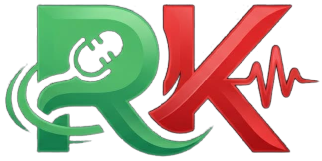

# REKA

### La console de mixage tout-en-un pour Windows

Voicemeeter pour le son, tes plugins VST pour les effets, **une seule fenêtre** pour tout piloter.

<br>

[](https://github.com/1337133713377/reka/releases/latest)
[](https://github.com/1337133713377/reka/releases)
[](https://github.com/1337133713377/reka/actions)


<br>

<a href="https://github.com/1337133713377/reka/releases/latest/download/REKA.exe">
  
</a>

<sub>Un seul fichier, rien à installer · mises à jour automatiques</sub>

<br><br>

[Aperçu](#apercu) · [Démarrer](#demarrer) · [Fonctions](#fonctions) · [Thèmes](#themes) · [Moteurs d'effets](#moteurs) · [Aide](#aide)

</div>

<a id="apercu"></a>

<p align="center">
  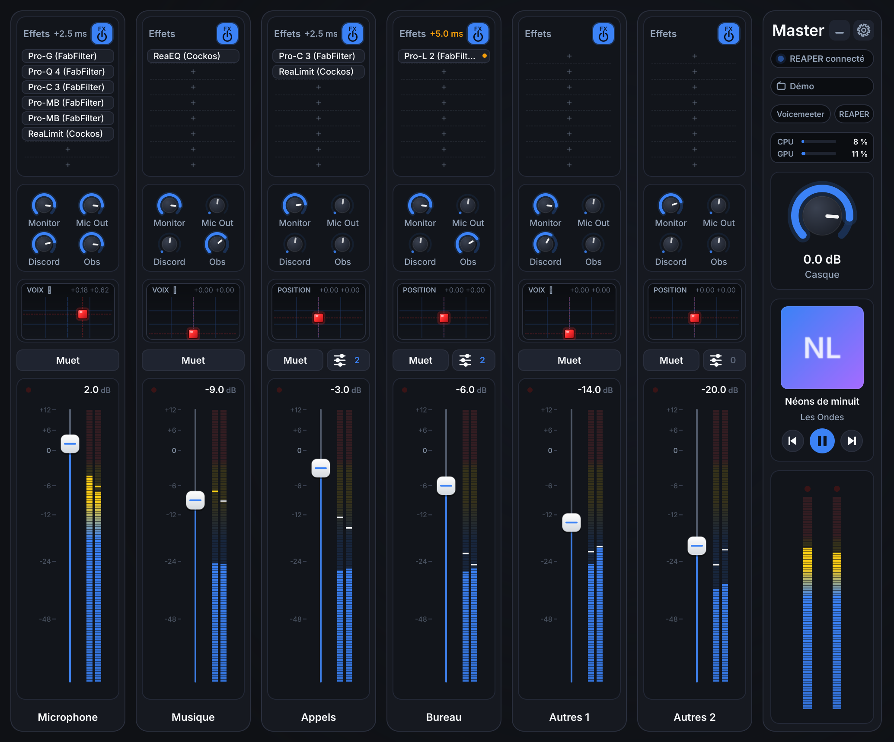
</p>

<br>

## ✨ En bref

<table>
<tr>
<td width="33%" valign="top">

### 🎚️ Une seule console

Faders, mutes, VU-mètres et routing de **Voicemeeter Potato ou Banana**, sans jamais ouvrir sa fenêtre.

</td>
<td width="33%" valign="top">

### 🎛️ Tes VST, strip par strip

Ajoute, coupe, règle et **déplace à la souris** tes plugins VST2, VST3 et CLAP sur chaque entrée.

</td>
<td width="33%" valign="top">

### 🔀 Routing en un clic

Quatre knobs par strip : **Monitor, Mic Out, Discord, Obs**. Un clic pour envoyer, un glisser pour doser.

</td>
</tr>
<tr>
<td valign="top">

### 📊 Charge CPU et GPU

Deux jauges montrent ce que coûtent tes effets. Un clic droit **mesure un plugin précis**.

</td>
<td valign="top">

### 🎧 Volume par application

Discord, Spotify, ton jeu, ton navigateur : chacun son volume et son mute, **depuis la strip**.

</td>
<td valign="top">

### 🎨 Douze thèmes

Synthwave, Matrix, Sakura, Braise… ou **ta couleur pour chaque élément** et ton image de fond.

</td>
</tr>
</table>

<br>

<a id="demarrer"></a>

## 🚀 Démarrer en 3 étapes

| | Étape | Détail |
|:-:|---|---|
| **1** | **Installe les moteurs** | [Voicemeeter Potato](https://vb-audio.com/Voicemeeter/potato.htm) ou [Banana](https://vb-audio.com/Voicemeeter/banana.htm), et pour les effets [REAPER](https://www.reaper.fm/download.php) (ou FL Studio, ou Equalizer APO). |
| **2** | **Lance REKA** | [Télécharge `REKA.exe`](https://github.com/1337133713377/reka/releases/latest/download/REKA.exe) et ouvre-le. Au premier lancement, tu choisis ton édition de Voicemeeter et ton moteur d'effets. |
| **3** | **Branche les effets** *(une seule fois, avec REAPER)* | ⚙ → **Ouvrir les préférences audio de REAPER** → *Audio system* : **ASIO** → pilote : **Voicemeeter Insert Virtual ASIO**. |

> [!TIP]
> Tu veux juste voir à quoi ça ressemble ? Lance `REKA.exe --demo` : la console s'ouvre avec des moteurs simulés, sans Voicemeeter ni REAPER.

> [!NOTE]
> Il manque un moteur ? REKA te donne le lien de téléchargement, ou te laisse indiquer où il est installé.

<br>

<a id="fonctions"></a>

## 🎛️ Ce que tu peux faire

<table>
<tr>
<td width="56%">
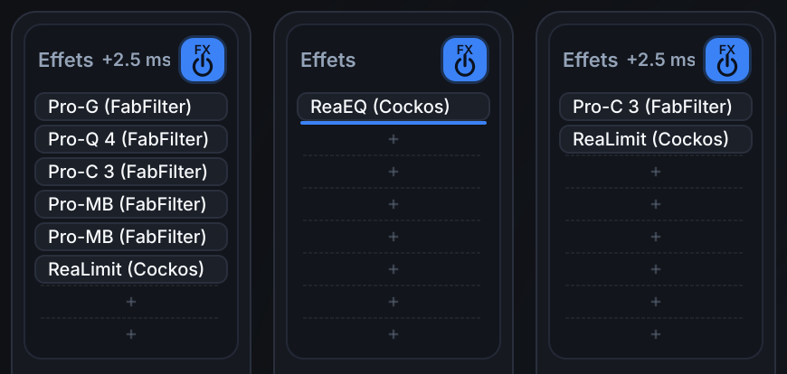
</td>
<td valign="top">

### Des effets que tu ranges à la main

- **Clic sur « + »** : ajoute un plugin depuis la liste de tes VST.
- **Clic sur un effet** : ouvre son interface.
- **Glisser** : change son ordre, ou envoie-le sur une autre strip **avec ses réglages**. <kbd>Ctrl</kbd> = copier.
- **Clic droit** : bypass, mesure de sa charge CPU, suppression.
- **Badge FX** : coupe toute la chaîne d'un coup.
- **+2.5 ms** : le délai que les plugins ajoutent à ta voix. Un point ambre signale un plugin lent.

</td>
</tr>
</table>

<table>
<tr>
<td valign="top">

### Un Master qui dit tout

- **Badge de connexion** : vert, tout répond ; rouge, un moteur a décroché.
- **Projet** : change de projet REAPER à chaud.
- **Voicemeeter / REAPER** : affiche leur fenêtre si tu en as besoin.
- **CPU et GPU** : la charge de tes effets, en ambre puis en rouge quand ça chauffe.
- **Casque** : le volume de ta sortie principale.
- **Musique en cours** : pochette, titre, précédent / pause / suivant.

</td>
<td width="26%">
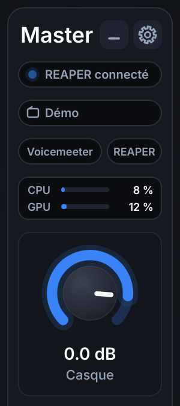
</td>
</tr>
</table>

<table>
<tr>
<td width="44%">
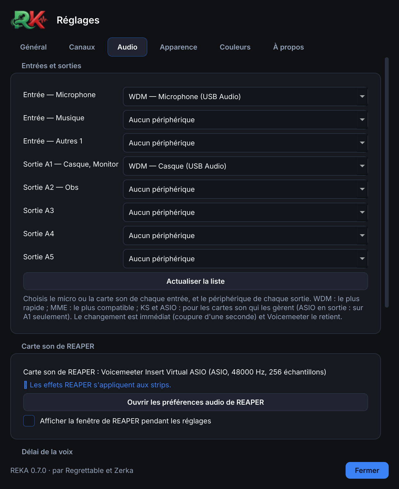
</td>
<td valign="top">

### Tes entrées, tes sorties

Dans ⚙ → **Audio**, choisis sans ouvrir Voicemeeter :

- le **micro ou la carte son** de chaque entrée ;
- le **périphérique de chaque sortie** (A1 pour ton casque, A2 pour OBS…) ;
- le pilote : **WDM** (le plus rapide), **MME** (le plus compatible), **KS** ou **ASIO**.

Et juste en dessous, le **tampon audio** : plus il est petit, plus ta voix arrive vite.

</td>
</tr>
</table>

<details>
<summary><b>🖱️ Tous les gestes de la console</b></summary>

<br>

| Élément | Geste |
|---|---|
| **Fader** | glisser (<kbd>Maj</kbd> = précis) · molette · double-clic = 0 dB |
| **Knob d'envoi** | clic = on/off · glisser ou molette = niveau |
| **Intellipan** (carré au cube rouge) | glisser le cube · double-clic = neutre · clic sur le titre = changer de mode |
| **Muet** | coupe la strip |
| **Apps** (strips virtuelles) | volume et mute de chaque application |
| **Effet** | clic = interface · glisser = déplacer · <kbd>Ctrl</kbd> + glisser = copier · clic droit = options |
| **Emplacement « + »** | ajouter un effet |
| **Badge FX** | bypass de toute la chaîne |
| **Nom de la strip** | double-clic = renommer |
| **Knob Casque** | volume du casque · double-clic = 0 dB |
| **⚙** | tous les réglages |
| **–** | réduire, dans la barre des tâches ou près de l'horloge |

</details>

<br>

<a id="themes"></a>

## 🎨 Douze thèmes, ou le tien

Un clic dans ⚙ → **Apparence** et toute la console change : couleurs, faders, VU-mètres.

<table>
<tr>
<td align="center">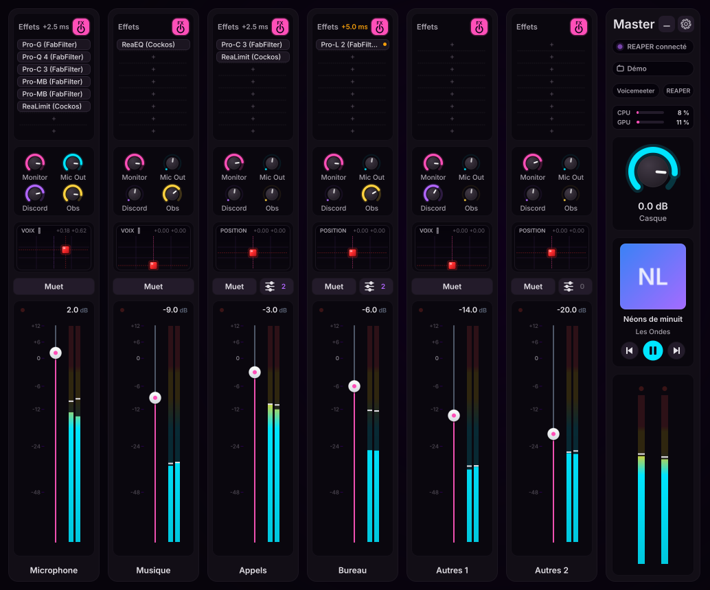<br><b>Synthwave</b></td>
<td align="center">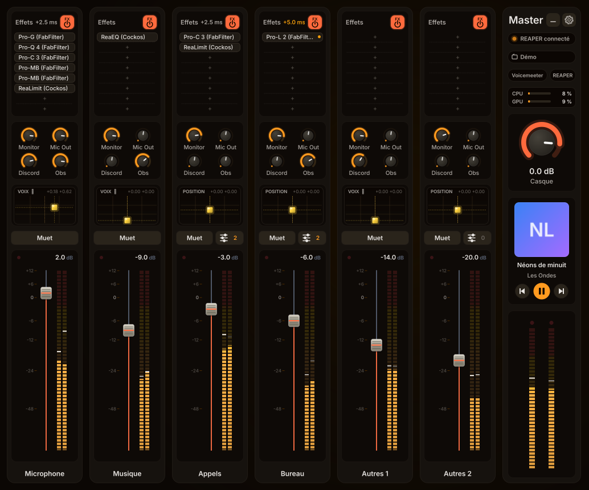<br><b>Braise</b></td>
<td align="center">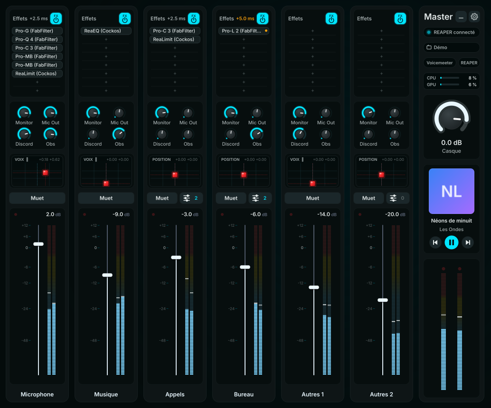<br><b>Glace</b></td>
</tr>
<tr>
<td align="center">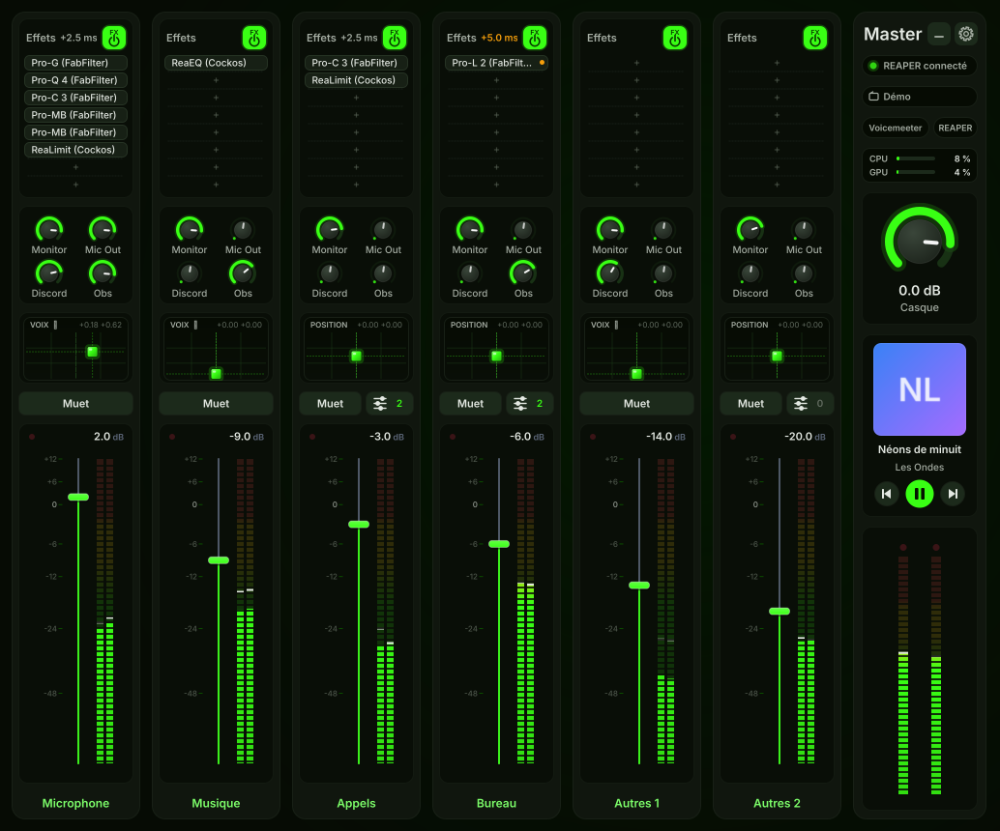<br><b>Matrix</b></td>
<td align="center">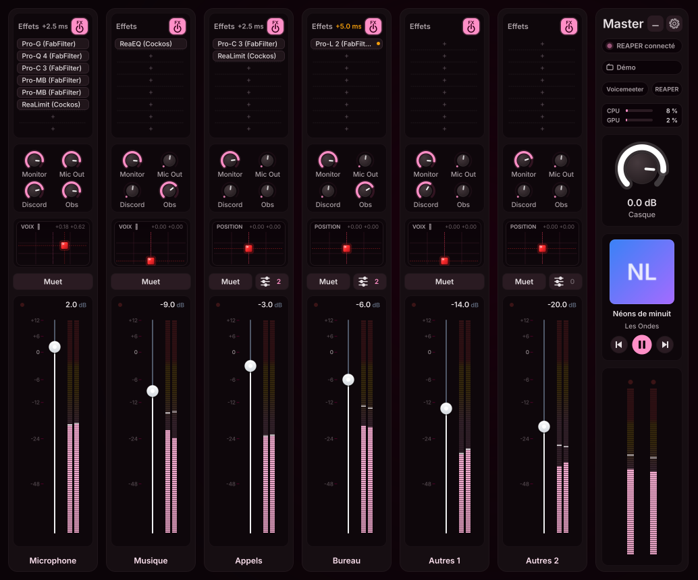<br><b>Sakura</b></td>
<td align="center">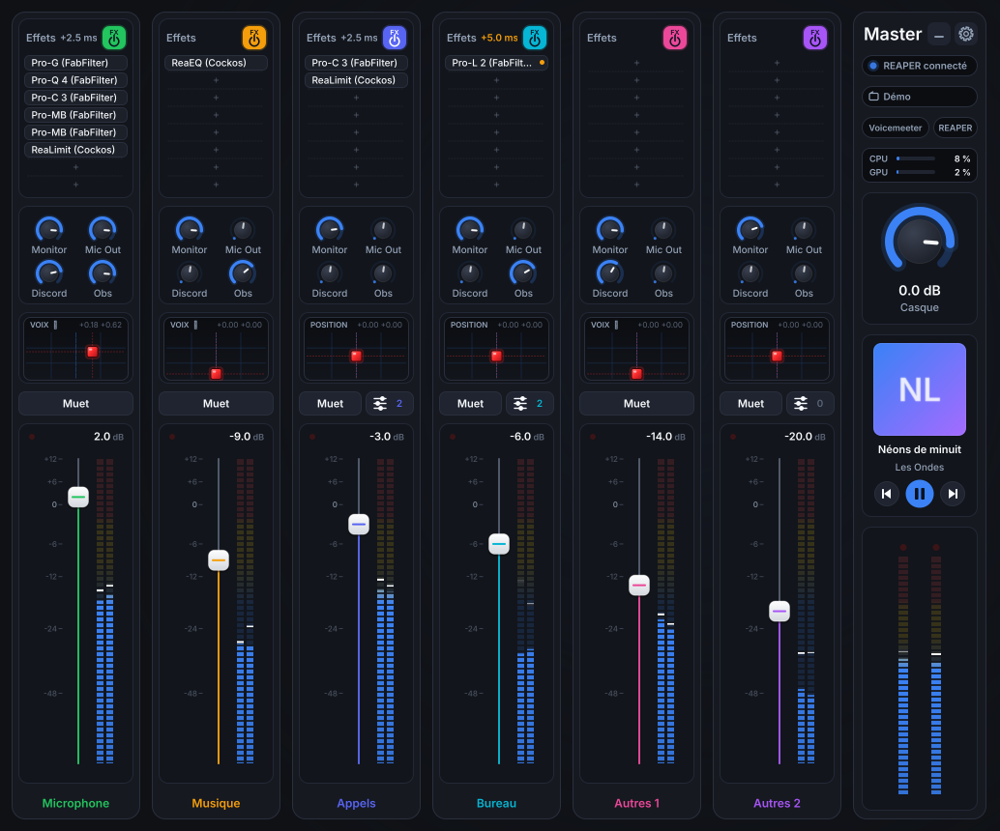<br><b>Arcade</b> · une couleur par canal</td>
</tr>
</table>

<p align="center">
  <sub>Et aussi : Dark Studio Pro · Néon · Or noir · Océan · Rubis · Monochrome</sub>
</p>

<details>
<summary><b>🖌️ Aller plus loin dans la personnalisation</b></summary>

<br>

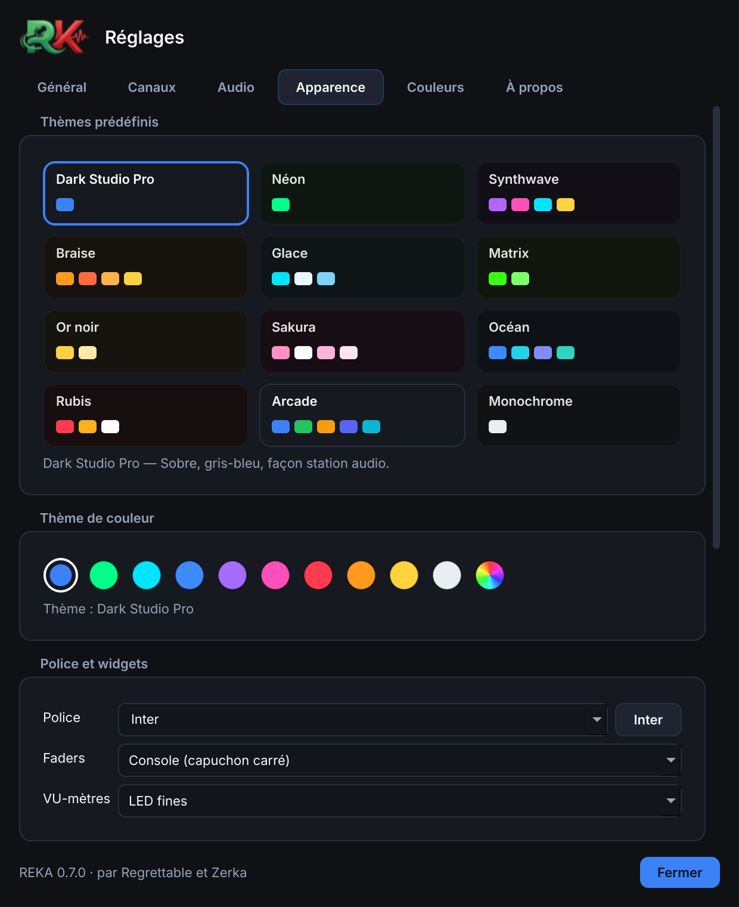

- **Couleur d'accent** : dix teintes, ou n'importe quelle couleur.
- **Couleur de chaque élément** : chaque knob, fader, VU-mètre, bouton… pour toute la console, pour un seul canal ou pour le Master.
- **Image d'arrière-plan**, avec assombrissement et transparence des panneaux.
- **Style des faders** : console, rond, fin, vintage.
- **Style des VU-mètres** : LED fines, LED larges, continu.
- **Police** de toute l'interface.

<br clear="right">

</details>

<br>

<a id="moteurs"></a>

## 🔌 Quatre moteurs d'effets au choix

| Moteur | Ce que REKA pilote | Délai ajouté à la voix |
|---|---|---|
| **REAPER** *(conseillé)* | plugins VST2 / VST3 / CLAP : ajout, bypass, interface, déplacement, projets | 2 tampons ASIO + plugins |
| **FL Studio** | lancement et envoi du son ; les effets se règlent dans FL Studio | 2 tampons ASIO + plugins |
| **Equalizer APO** | plugins VST2 64 bits, appliqués directement par Windows | plugins seulement |
| **Aucun** | Voicemeeter seul : volumes, routing, VU-mètres | aucun |

Tu changes de moteur quand tu veux dans ⚙ → **Général** ; REKA redémarre pour l'appliquer.

<br>

<a id="aide"></a>

## ❓ Un souci ?

<details>
<summary><b>Windows affiche « Windows a protégé votre ordinateur »</b></summary>

<br>

`REKA.exe` n'est pas signé numériquement, donc Windows SmartScreen prévient au premier lancement. Clique sur **Informations complémentaires**, puis **Exécuter quand même**.

</details>

<details>
<summary><b>Mes effets ne changent pas le son</b></summary>

<br>

Ouvre ⚙ → **Audio** : la carte son de REAPER doit indiquer **Voicemeeter Insert Virtual ASIO**. Si ce n'est pas le cas, refais l'étape 3 du démarrage. Tant que ce pilote n'est pas choisi, REKA laisse passer le son sans effets plutôt que de le couper.

</details>

<details>
<summary><b>« REAPER ne répond pas » au démarrage</b></summary>

<br>

Au tout premier lancement, REAPER analyse tes plugins et peut mettre une minute : clique sur **Réessayer**. Vérifie aussi qu'aucune fenêtre de REAPER (licence d'évaluation, message) n'attend une réponse.

</details>

<details>
<summary><b>Le son craque</b></summary>

<br>

Remonte le tampon d'un cran dans ⚙ → **Audio** → *Tampon de Voicemeeter*, et regarde les jauges CPU / GPU du Master : un clic droit sur un effet → **Mesurer sa charge CPU** te dit lequel pèse le plus.

</details>

<details>
<summary><b>Comment se font les mises à jour ?</b></summary>

<br>

Toutes seules. REKA vérifie au démarrage puis régulièrement ; quand une version est prête, une pill **Mise à jour** apparaît dans le Master. Un clic, et REKA se remplace puis redémarre en gardant tes réglages.

</details>

<details>
<summary><b>Où sont mes réglages et le journal ?</b></summary>

<br>

Dans `%APPDATA%\REKA` : `config.json` pour les réglages, `app.log` pour le journal. Raccourci : ⚙ → *Ouvrir le dossier des journaux*.

</details>

<br>

📖 **Tout le détail** — Intellipan, projets REAPER, Equalizer APO, correspondance des canaux, fonctionnement interne — est dans la [documentation complète](reaper_mixer/README.md). Les changements de chaque version sont dans les [nouveautés](reaper_mixer/NOUVEAUTES.md).

<br>

## 🛠️ Pour les développeurs


```bash
cd reaper_mixer
python -m pip install -r requirements.txt pytest
python main.py --demo        # la console avec des moteurs simulés
python -m pytest tests       # les tests
```

Chaque push construit et teste `REKA.exe` sur GitHub ; pousser un tag `v…` publie une release. L'architecture est décrite dans la [documentation complète](reaper_mixer/README.md#développement).

<br>

---

<div align="center">


**REKA** est développé par **Regrettable** et **Zerka**

Merci à **206** pour sa contribution

</div>
